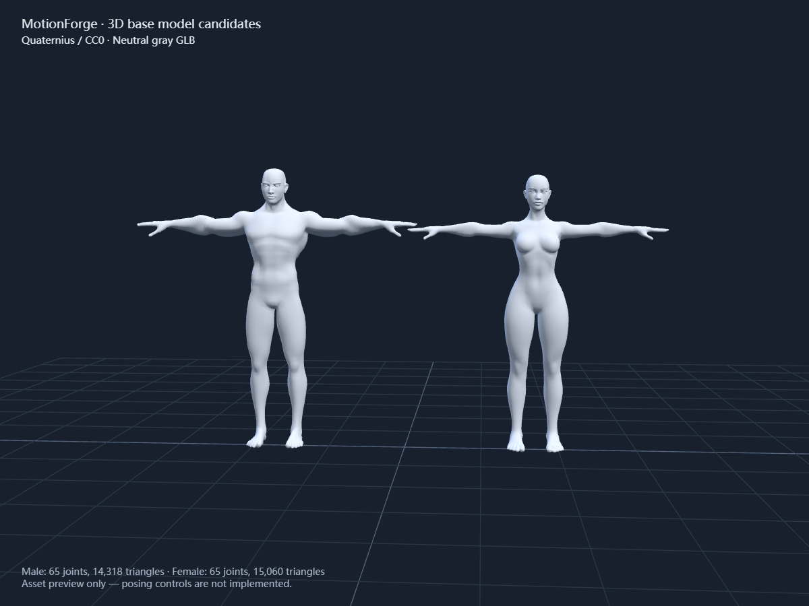

# Quaternius 人体素体资产

下载日期：2026-10-27。

- 作者：Quaternius。
- 官方介绍：https://quaternius.com/packs/universalbasecharacters.html
- 官方下载：https://quaternius.itch.io/universal-base-characters
- 下载内容：免费 Universal Base Characters[Standard].zip，128,968,391 字节；未购买 Source 包。
- 许可：包内 License_Standard.txt 标注 CC0 1.0，原文保留于本目录及运行时模型目录。
- 定位：类似 UE 假人用途的带蒙皮人体素体，不是 Epic Manny/Quinn 原模型，也不保证 UE 骨架直接兼容。

## 可用文件

| 文件 | 大小 | 骨架 | 三角形 | 用途 |
| --- | --- | --- | --- | --- |
| [mannequin-male.glb](../../../public/models/quaternius/mannequin-male.glb) | 741,144 字节 | 65 个 skin joints | 14,318 | 首选默认候选 |
| [mannequin-female.glb](../../../public/models/quaternius/mannequin-female.glb) | 1,012,376 字节 | 65 个 skin joints | 15,060 | 备用素体 |

二者各有 69 个节点、3 个 mesh，所有 mesh primitive 都有 JOINTS_0 / WEIGHTS_0。文件为自包含 GLB，没有外部纹理或网络依赖。实际数据与哈希见 [manifest.json](./manifest.json)。

## 来源与处理

原模型路径为压缩包内 Base Characters/Godot - UE/Superhero_Male_FullBody.gltf 与 Superhero_Female_FullBody.gltf，及各自 .bin。保留原几何、法线、骨架层级、节点变换、skin weights、inverse bind matrices 和静止姿态；将材质统一替换为不依赖纹理的中性灰，再封装 GLB。不包含动作导入或 IK 设置。

原包的部分纹理 URI 与实际文件名不一致；本次中性灰版本明确移除全部纹理引用，因此不依赖这些路径。原 ZIP 留在下载机器的临时资源缓存中，不把 123 MiB 压缩包加入 Git；作者来源、包哈希、许可及可复现脚本均已记录。

转换命令（在项目根目录运行，参数为官方下载的 Standard ZIP）：

```sh
node scripts/prepare-mannequin.mjs "path/to/Universal Base Characters[Standard].zip"
```

正式 3D 接入仍需验证：米制/朝向规范化、语义骨骼路径映射、肘膝 pole plane、肩髋变形和 IK/FK。下载并通过格式检查不代表这些控制器已经完成。

## 实际检查

已使用 Khronos glTF Validator 检查两个 GLB：各 0 errors、3 warnings。警告均为原模型的 NODE_SKINNED_MESH_NON_ROOT，另有移除贴图后保留 UV 的 unused 信息。原骨骼/节点层级未擅自重排；D1 接入需验证根变换与 skinned mesh 的组合方式，不能忽略该警告。完整报告见 validation.json。

已用临时 Three.js 查看器在 Chrome 中实际加载并渲染两模型，均成功。源模型高度约男性 1.820、女性 1.775（源坐标单位），最低点略低于 0；规范化时应处理落地位置。此检查没有实现或验收 IK。


